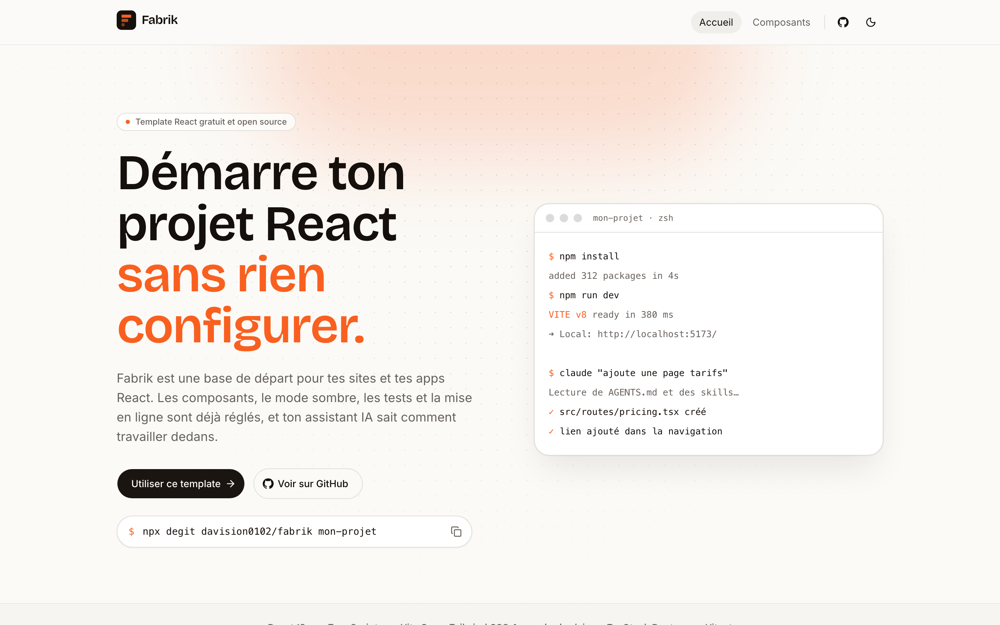

<div align="center">


# Fabrik

Un template React gratuit pour démarrer un site ou une app sans passer une heure à tout configurer.

[](https://github.com/davision0102/fabrik/actions/workflows/ci.yml)
[](https://davision0102.github.io/fabrik/)


[Voir la démo](https://davision0102.github.io/fabrik/) · [Utiliser ce template](https://github.com/davision0102/fabrik/generate)



</div>

## Pourquoi j'ai fait ça

À chaque nouveau projet, je refaisais la même chose : installer React, régler Tailwind, ajouter des composants, le mode sombre, le lint, les tests, la mise en ligne… Avant d'écrire la moindre ligne utile, la matinée était passée.

Fabrik, c'est cette base, faite une bonne fois pour toutes. Je l'utilise pour mes propres projets et je la partage telle quelle.

J'y ai aussi ajouté ce qui me manquait quand je code avec une IA : des instructions claires pour que l'assistant comprenne le projet au lieu de deviner.

## Ce qu'il y a dedans

- React 19, TypeScript, Vite 8 et Tailwind CSS 4
- Des composants [shadcn/ui](https://ui.shadcn.com) : boutons, champs, fenêtres, cartes. Ils sont dans ton projet, tu les modifies librement.
- Des pages créées à partir des fichiers grâce à TanStack Router : un fichier dans `src/routes/` donne une page.
- Un mode clair et un mode sombre, sans clignotement au chargement
- ESLint, Prettier et Vitest, lancés automatiquement à chaque commit et sur GitHub
- Une mise en ligne automatique sur GitHub Pages
- Un fichier `AGENTS.md` et 8 fiches pratiques pour les assistants IA (plus de détails plus bas)

## Démarrer

Le plus simple : clique sur **Use this template** en haut de cette page, puis clone ton nouveau dépôt.

Tu peux aussi le copier en ligne de commande :

```bash
npx degit davision0102/fabrik mon-projet
cd mon-projet
npm install
npm run dev
```

Le site s'ouvre sur [localhost:5173](http://localhost:5173) et se recharge à chaque sauvegarde.

Pour lui donner ton nom, ouvre `src/config/site.ts` : le nom, la description et les liens sont tous au même endroit.

## Les commandes

| Commande          | Ce qu'elle fait                                         |
| ----------------- | ------------------------------------------------------- |
| `npm run dev`     | lance le site en local                                  |
| `npm run build`   | vérifie le code et prépare la version à mettre en ligne |
| `npm run preview` | affiche cette version en local                          |
| `npm run lint`    | cherche les erreurs dans le code                        |
| `npm run format`  | remet le code en forme                                  |
| `npm test`        | lance les tests                                         |

## Travailler avec une IA

Si tu utilises Claude Code, Codex, Cursor ou Copilot, ils lisent le fichier `AGENTS.md` à la racine. Il leur explique la structure du projet, les commandes et les règles à suivre, comme les couleurs du thème ou l'endroit où mettre une nouvelle page.

Pour les tâches courantes, il y a aussi des fiches pas à pas dans `.agents/skills/` :

| Fiche           | Pour…                                                  |
| --------------- | ------------------------------------------------------ |
| `add-page`      | créer une page et l'ajouter au menu                    |
| `add-component` | installer un composant ou en créer un                  |
| `add-form`      | faire un formulaire avec vérification des champs       |
| `fetch-data`    | afficher des données venant d'une API                  |
| `add-test`      | écrire un test                                         |
| `design-system` | respecter les couleurs, les polices et les espacements |
| `deploy`        | mettre le site en ligne                                |
| `rebrand`       | renommer le projet et changer son identité             |

Concrètement, tu peux demander « ajoute une page tarifs avec trois offres » et l'assistant suivra la fiche `add-page` au lieu d'improviser.

Le fichier `.mcp.json` connecte aussi l'assistant au catalogue shadcn, pour qu'il puisse trouver et installer des composants tout seul.

## Mettre en ligne

Le site se publie sur GitHub Pages à chaque envoi sur `main`. Il y a un seul réglage à faire, une fois : dans ton dépôt, va dans **Settings › Pages** et choisis **GitHub Actions** comme source.

Vercel, Netlify et Cloudflare Pages fonctionnent aussi : tu importes le dépôt et ils détectent tout seuls qu'il s'agit d'un projet Vite. La fiche `deploy` explique les petites différences.

## Comment c'est rangé

```
src/
  config/site.ts      nom, textes et liens du projet
  routes/             les pages (un fichier = une page)
  components/         les composants du site
  components/ui/      les composants shadcn/ui
  hooks/              la logique réutilisable
  index.css           le thème : couleurs, polices, arrondis
.agents/skills/       les fiches pour les assistants IA
```

## Personnaliser

- **Le nom et les textes** se trouvent dans `src/config/site.ts`.
- **La couleur principale** est la variable `--brand` dans `src/index.css`. Il y en a une pour le mode clair et une pour le mode sombre.
- **Les polices** se règlent avec `--font-heading` et `--font-sans`, dans le même fichier.
- **Un nouveau composant** s'ajoute avec `npx shadcn@latest add <nom>`. Il apparaît ensuite sur la page `/ui` du site.

## Contribuer

Une idée, un bug, une fiche qui manque ? Ouvre une issue ou une pull request, je regarde tout.

Les modifications passent par une pull request : la branche `main` est protégée et les vérifications automatiques doivent être au vert avant de fusionner.

## Licence

MIT. Tu peux l'utiliser pour ce que tu veux, y compris des projets commerciaux.
